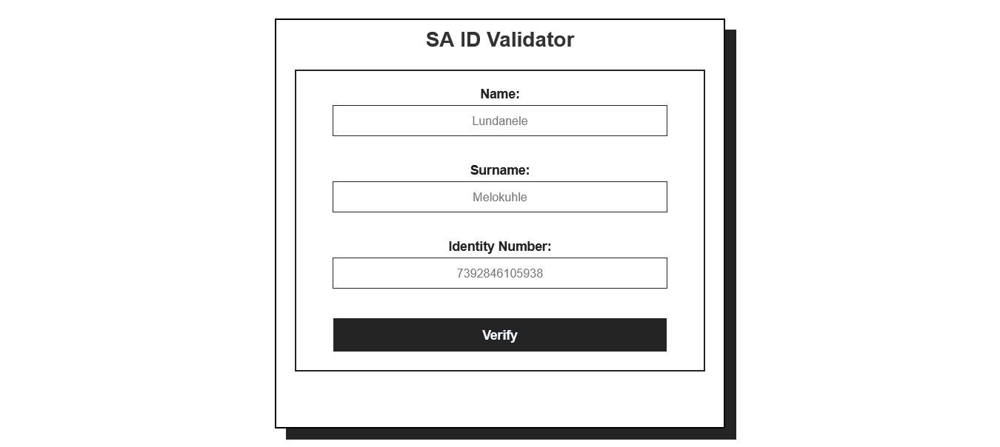
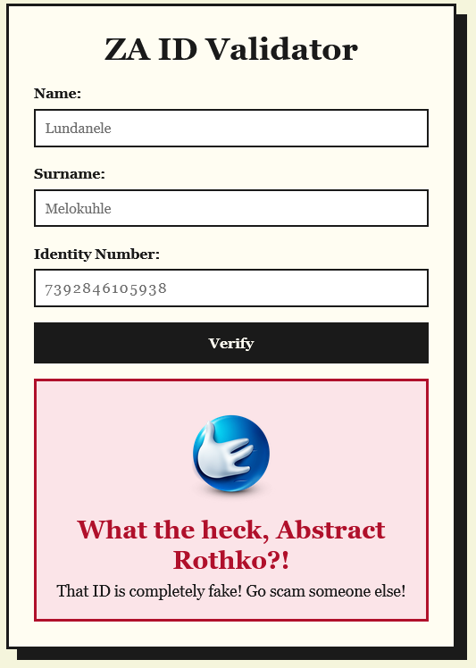

# South African ID Validator

This website is able to detect if the id number someone uses is a real, valid Id number or not. It then updates with a funny response depending on whether or not the id number presented is valid.

LIVE DEMO: 

## The ID Logic

ID numbers in South Africa follow a verify specific structure and because of this it is very easy to create a set of functions that are able check if an id number is valid or not.

Let's look at the following fake ID Number: 8001015009087 (Note: This is a number Gemini provided when I googled it, so any matches to a real person is coincidental).

The Format: `YYMMDD SSSS C A Z`

### The birthdate(YYMMDD)

The first six numbers are a person's birthdate.
Using the example provided would be 80-01-01(1st January 1980).

### The Sex(SSSS)

The next four numbers indicate the gender of the person.

Female: 0000 - 4999
Male: 5000 - 9999

This means that we can conclude that the id number would be given to a male.

### Citizenship Status

The next number indicates the citizen status of the person.

0 - Born Citizen
1 - Permanent Resident
2 - Refugee (Note: There are conflicting articles on the validity of this one, but my poor research and sense of morality will allow it)

This means that we can conclude that the id number belongs to someone born in SA.

### Legacy Number(A)

It sounds cool, but apparently this was historically used for used for race. Now it's just used for a standard number 8.
However, there are cases where it can be 9.

The id number passes this check.

### Checksum Number(Z)

This can be any number 0 - 9 and is used for the luhn algorithm. For more info on what that is and how works, click here[Wikipedia article on luhn algorithm](https://en.wikipedia.org/wiki/Luhn_algorithm)

Using the algorthm, the id number does indeed pass.

## Putting it live
Your project is plain static files with no build step, so GitHub Pages is the simplest option and you already have the repo (Abstract-Rothko/id-validator).

1. Add the .gitattributes, commit your fixes and git push origin main.
2. On GitHub, open the repo and go to Settings → Pages.
3. Under Build and deployment, choose Deploy from a branch, then pick main and / (root), and click Save.
4. After a minute or two it appears at https://abstract-rothko.github.io/id-validator/.
5. Open it in an incognito window and check that the images, favicon and CSS load, and that the form works. Paths are case-sensitive on GitHub’s servers, so assets/Laughing.png would fail where laughing.png works.
6. Paste the URL into the repo’s About box and the top of your README.

## Images
### Home Screen

### Correct Submission

### Incorrect Submission
